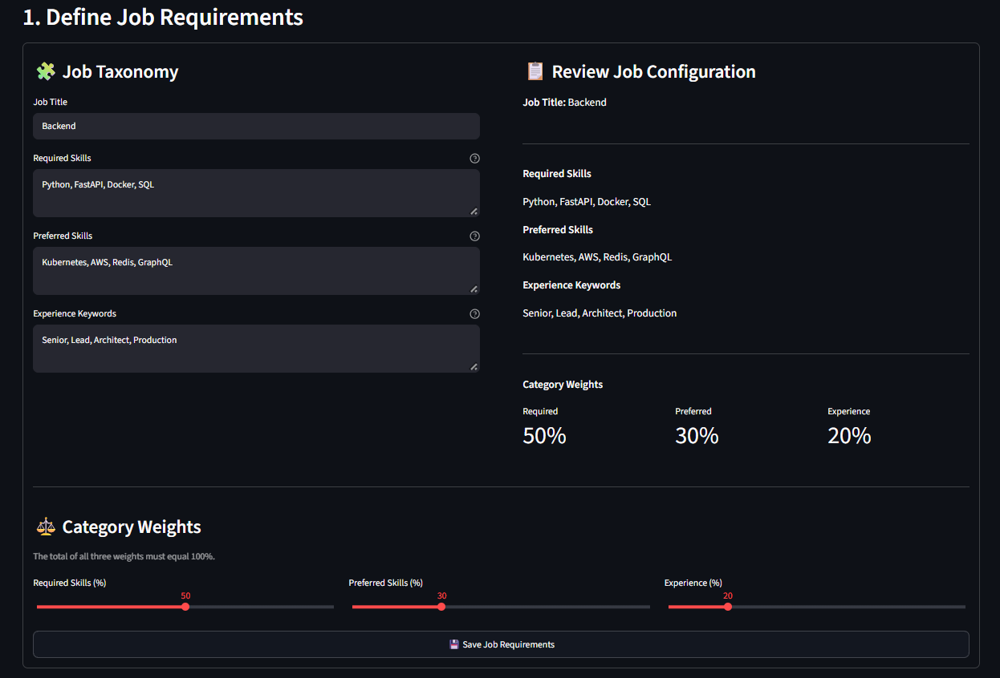
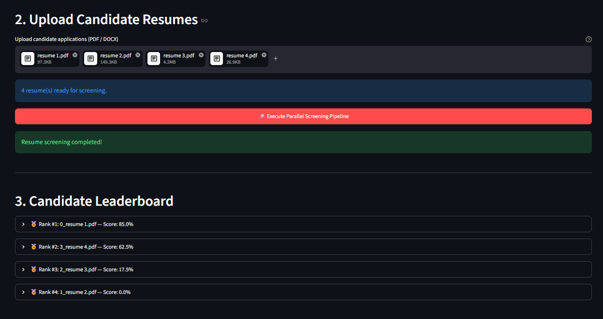

# Resume Scanner

[**Live demo**](https://resumescanner-6as.streamlit.app/)

A local Streamlit application for screening a batch of candidate resumes against configurable job requirements. Define the role, choose the scoring weights, upload PDF or DOCX resumes, and review a ranked leaderboard with matched-keyword details.

> **Scoring note:** This project uses literal keyword matching. It does not use an AI model, understand synonyms, assess candidate quality, or make hiring decisions. Treat scores as a review aid and inspect original resumes before making decisions.

## Screenshots

### Configure job requirements



### Upload resumes and review the leaderboard



## Features

- Configure a job title, required skills, preferred skills, and experience keywords.
- Set category weights; all three weights must total 100% before screening.
- Upload multiple PDF and DOCX resumes in one batch.
- Extract text and score resumes concurrently using a multiprocessing pool.
- See candidates sorted by score, with matched keywords for each category.
- Display parsing or processing failures alongside successful results.

## Requirements

- Python 3.10 or newer
- Packages listed in [`requirements.txt`](requirements.txt)

## Run locally

### Windows PowerShell

```powershell
py -m venv .venv
.\.venv\Scripts\Activate.ps1
python -m pip install --upgrade pip
pip install -r requirements.txt
streamlit run app.py
```

### macOS / Linux

```bash
python3 -m venv .venv
source .venv/bin/activate
python -m pip install --upgrade pip
pip install -r requirements.txt
streamlit run app.py
```

Streamlit prints a local URL (usually `http://localhost:8501`) to open in your browser. Save job requirements before uploading resumes.

## How scoring works

The screening engine extracts text from each PDF or DOCX and checks whether each configured keyword appears in the extracted text (case-insensitively). For each category, it calculates the fraction of that category's keywords found. The final score is the weighted sum of those fractions, expressed as a percentage:

```text
score = required_match_ratio × required_weight
      + preferred_match_ratio × preferred_weight
      + experience_match_ratio × experience_weight
```

Keywords are comma-separated. Matching is literal substring matching, so wording, spelling, and extracted document text affect results. A scanned PDF without an embedded text layer may yield little or no text because OCR is not included. Empty optional categories contribute zero to the score.

## Project layout

```text
resume_scanner/
├── app.py                     # Streamlit user interface and upload workflow
├── scanner/
│   └── screener_engine.py     # PDF/DOCX extraction and parallel keyword scoring
├── screenshots/               # README screenshots
├── requirements.txt           # Python dependencies
└── README.md
```

## Resume handling and privacy

Uploaded files are temporarily written to `uploaded_resumes/` while screening runs. The app removes that directory when the run finishes, including when processing raises an exception. Use this locally with resumes you are authorized to process, and avoid committing resumes, extracted candidate data, or secrets to version control.

## License

Distributed under the MIT License. See [`LICENSE`](LICENSE).
